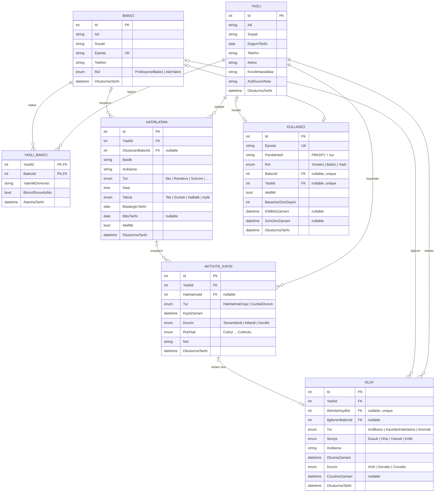

# ER Diyagramı

## Varlıklar ve modüllerle eşleşmesi

| Varlık | Açıklama | Karşıladığı modül |
|---|---|---|
| **Yasli** | Bakım alan kişinin profili | Yaşlı profili |
| **Bakici** | Profesyonel bakıcı veya aile yakını | Yakın paneli |
| **YasliBakici** | Yaşlı–bakıcı eşleştirmesi (ara tablo) | Yakın paneli |
| **Hatirlatma** | İlaç, randevu, su vb. zamanlanmış hatırlatma | Hatırlatma |
| **AktiviteKaydi** | Hatırlatma onayı veya günlük durum bildirimi | Günlük durum |
| **Olay** | Yakınlara giden uyarı/alarm | Anomali bildirimi, Acil buton |
| **Kullanici** | Giriş hesabı (e-posta, parola hash'i, rol) | Kimlik doğrulama (Hafta 5) |

## İlişkiler

| İlişki | Tür | Açıklama |
|---|---|---|
| Yasli ↔ Bakici | **N-N** | Bir yaşlıya birden fazla kişi bakabilir, bir bakıcı birden fazla yaşlıyı takip edebilir. `YasliBakici` ara tablosu ile çözülür. |
| Yasli → Hatirlatma | **1-N** | Bir yaşlının çok sayıda hatırlatması olur; her hatırlatma tek bir yaşlıya aittir. |
| Bakici → Hatirlatma | **1-N** (opsiyonel) | Hatırlatmayı oluşturan bakıcı. Bakıcı silinirse alan `NULL` olur. |
| Yasli → AktiviteKaydi | **1-N** | Yaşlının tüm onay ve günlük durum kayıtları. |
| Hatirlatma → AktiviteKaydi | **1-N** (opsiyonel) | Bir hatırlatma her tekrarında bir kayıt üretir. Günlük durum kayıtlarında boştur. |
| Yasli → Olay | **1-N** | Yaşlıya ait tüm alarmlar. |
| Bakici → Olay | **1-N** (opsiyonel) | Alarmla ilgilenen bakıcı. |
| AktiviteKaydi → Olay | **1-1** (0..1) | Atlanan bir ilaç kaydı en fazla bir alarm üretir. `AktiviteKaydiId` üzerinde benzersiz (unique) indeks vardır. |

## Normalizasyon notları

- **1NF:** Her alan tek (atomik) değer tutar. Bir yaşlının birden fazla bakıcısı virgülle ayrılmış bir alanda değil, ayrı satırlarda (`YasliBakici`) tutulur.
- **2NF:** Bileşik anahtarlı tek tablo `YasliBakici`dir; `YakinlikDerecesi` ve `BirincilSorumluMu` anahtarın tamamına (o yaşlı **ve** o bakıcı) bağlıdır.
- **3NF:** Geçişli bağımlılık yoktur. Örneğin hatırlatma kaydında yaşlının adı tekrar tutulmaz, yalnızca `YasliId` tutulur. Tür, durum gibi sabit listeler enum olarak saklanır.
