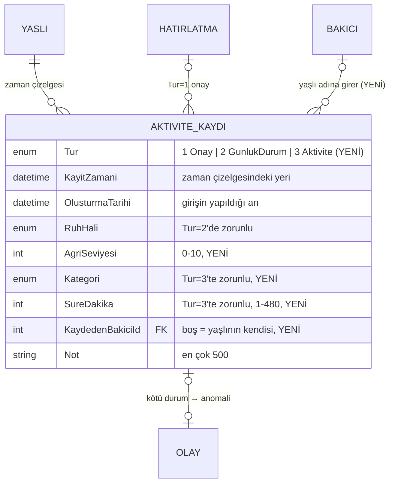

# Günlük Durum ve Aktivite Kaydı (Hafta 7)

Yaşlı, panelinden günde bir kez **nasıl hissettiğini** (ruh hali, isteğe bağlı ağrı seviyesi ve not) bildirir. Ayrıca yaptığı işleri (**yürüyüş, egzersiz, ziyaret/telefon, ev işi, hobi**) süresiyle birlikte kaydeder. Bakıcı da kendisine atanmış yaşlı adına aktivite girebilir. Bütün kayıtlar hatırlatma onaylarıyla birlikte tek bir **geçmiş** ekranında gün gün gösterilir. Kötü ruh hali ya da yüksek ağrı bildirildiğinde yakınlara olay (anomali) oluşur.

## Dosyalar

| Katman | Dosya | Görev |
|---|---|---|
| Veri modeli | [AktiviteKaydi.cs](../YasliBakim.Entities/Concrete/AktiviteKaydi.cs), [AktiviteKategorisi.cs](../YasliBakim.Entities/Enums/AktiviteKategorisi.cs) | Yeni alanlar: `AgriSeviyesi`, `Kategori`, `SureDakika`, `KaydedenBakiciId`; yeni tür `Aktivite` |
| İş kuralları | [AktiviteKurallari.cs](../YasliBakim.Business/Kurallar/AktiviteKurallari.cs) | Süre/ağrı sınırları, geriye dönük sınır, anomali seviyesi, silme kuralı |
| Servis | [AktiviteManager.cs](../YasliBakim.Business/Concrete/AktiviteManager.cs) | Günlük durum (günde bir), aktivite ekle/sil, geçmiş, gün özeti |
| Veri erişim | [EfAktiviteKaydiRepository.cs](../YasliBakim.DataAccess/Concrete/EfAktiviteKaydiRepository.cs) | Geçmiş sorgusu, günün durum kaydı |
| Erişim | [YasliErisimi.cs](../yaslibakimapp/Guvenlik/YasliErisimi.cs) | `HedefYasliAsync`: sayfa hangi yaşlı için çalışacak? |
| Sayfa | [Panelim](../yaslibakimapp/Pages/Panelim.cshtml) | Yaşlı: "Bugün nasılsınız?" formu |
| Sayfa | [Aktiviteler/Yeni](../yaslibakimapp/Pages/Aktiviteler/Yeni.cshtml.cs) | Yaşlı veya bakıcı: aktivite girişi |
| Sayfa | [Aktiviteler/Gecmis](../yaslibakimapp/Pages/Aktiviteler/Gecmis.cshtml.cs) | Herkes (sahiplik kontrollü): gün özeti + tüm kayıtlar, filtre, silme |
| Sayfa | [Yaslilar/Detay](../yaslibakimapp/Pages/Yaslilar/Detay.cshtml) | Bakıcı: bugünkü durum ve son 7 günün özeti |
| Migration | `GunlukDurumVeAktivite` | 4 sütun, 1 FK, 3 CHECK |
| Test | [AktiviteTestleri](../YasliBakim.Tests/AktiviteTestleri.cs), [AktiviteSayfaTestleri](../YasliBakim.Tests/AktiviteSayfaTestleri.cs) | 41 test |

## Veri modeli

Yeni tablo açılmadı. Hafta 4'teki `AktiviteKayitlari` tablosu yaşlının **zaman çizelgesi** olarak genişletildi. Üç kayıt türü aynı tabloda durur, türe göre farklı alanlar dolar:

| Tür | Zorunlu alanlar | Kim girer |
|---|---|---|
| 1 Hatırlatma onayı | `HatirlatmaId`, `Durum`, `PlanlananZaman` | Yaşlı (Yaptım/Atla) veya sistem (kaçırıldı), Hafta 6 |
| 2 Günlük durum | `RuhHali` (ağrı ve not isteğe bağlı) | Yalnızca yaşlı (kendi beyanıdır) |
| 3 Aktivite | `Kategori`, `SureDakika` | Yaşlı veya atanmış bakıcı |

- **Neden tek tablo?** Geçmiş ekranı üç türü tek bir zaman çizelgesinde, tek sorgu ve tek indeksle (`IX_AktiviteKaydi_Yasli_Zaman`) gösteriyor. Türe göre hangi alanın dolu olacağını veritabanı `CK_AktiviteKaydi_Tur` ile garanti ediyor. Ayrı tablolarda geçmiş için üç sorgu ve birleştirme gerekirdi.
- **İki zaman:** `KayitZamani` aktivitenin *yapıldığı* andır (geriye dönük girilebilir). `OlusturmaTarihi` ise *girişin yapıldığı* andır ve "24 saat içinde silinebilir" kuralı bu alana bakar. Dün yapılan yürüyüş bugün girilince geçmişte dünün altında görünür.
- **`KaydedenBakiciId`:** kaydı kimin girdiğini gösterir (hesap verebilirlik). Silme yetkisi de bu alana göre belirlenir. Bakıcı silinirse kayıt yaşlının geçmişinde kalır, alan `NULL` olur (`ON DELETE SET NULL`).
- **Gün özeti saklanmaz:** `GunOzeti` (ruh hali, ağrı, aktivite dakikası, alınan doz) kayıtlardan hesaplanır. Hafta 6'daki "türetilebilen veri saklanmaz" ilkesiyle aynı.
- **CHECK kısıtları:** `CK_AktiviteKaydi_Tur` (türe göre zorunlu alanlar), `CK_AktiviteKaydi_Agri` (0–10), `CK_AktiviteKaydi_Sure` (1–480).

## Doğrulama ve iş kuralları

| Kural | Nerede | Neden |
|---|---|---|
| **Günde bir günlük durum;** aynı gün tekrar bildirilirse kayıt güncellenir | Servis | Bakıcı günün son hâlini tek satırda görür; gün özeti belirsiz olmaz |
| Kötü / çok kötü ruh hali, ağrı ≥ 7 → olay (Orta); çok kötü veya ağrı ≥ 9 → Yüksek | `AktiviteKurallari.AnomaliSeviyesi` | Yakınlar kötü günü haber alır; ikisinden kötü olanı seviyeyi belirler |
| Bir günlük durumdan en fazla **bir** olay doğar | Servis | Gün içinde "kötü"yü iki kez bildirmek iki alarm göndermez (alarm yorgunluğu) |
| Ağrı 0–10, süre 1–480 dk, not en çok 500 karakter | Form + servis + CHECK | Her katmanda; formu atlayan istek de reddedilir |
| Ruh hali ve kategori geçerli enum olmalı | Servis (`Enum.IsDefined`) | `ruhHali=42` gibi uydurma bir değer gönderilemez |
| Gelecek zamana aktivite girilemez (5 dk saat farkı toleransı) | Servis | "Henüz yapılmamış" yürüyüş kaydedilmez |
| En fazla **2 gün** geriye dönük aktivite | Servis | Haftalar sonra hatırlanan kayıt güvenilmez, geçmiş sonradan "düzeltilemez" |
| Aynı dakikada aynı aktivite iki kez kaydedilmez | Servis | Butona iki kez basma (yaşlı kullanıcılarda sık) çift kayıt açmaz |
| Yalnızca **aktivite** silinebilir; onay ve günlük durum silinemez | Servis | Onay = uyum verisi, günlük durum = olayın kaynağı (ilişkili kayıt) |
| Aktiviteyi yalnızca **giren kişi**, **24 saat** içinde silebilir | `AktiviteKurallari.SilinebilirMi` | Yanlış giriş düzeltilebilir, ama başkasının kaydı ya da eski geçmiş silinemez |
| Geçmiş aralığı en fazla 31 gün, bitiş ≥ başlangıç | Servis | Sorgu boyutu sınırlı kalır |

## Erişim / sahiplik

| İşlem | Kim | Kontrol |
|---|---|---|
| Günlük durum bildirme | Yalnızca yaşlı, kendisi için | Yaşlı kimliği oturumdan alınır, formda yaşlı alanı yoktur |
| Aktivite girme | Yaşlı (kendisi) veya **atanmış** bakıcı | `HedefYasliAsync`: yaşlı için adres çubuğundaki `yasliId` **yok sayılır** |
| Geçmişi görme | Yaşlı (kendisi), atanmış bakıcı, yönetici | Aynı kontrol; atanmamış bakıcı → Erişim engellendi |
| Aktivite silme | Kaydı giren kişi | Servis: kayıt bu yaşlının mı + `KaydedenBakiciId` eşleşiyor mu |
| Yönetici | Yalnızca görüntüler | Yöneticinin bakıcı/yaşlı Id'si yoktur. Engellenmeseydi "yaşlının girdiği kayıt" gibi görünüp silebilirdi; bu yüzden ayrıca reddedilir (test var) |

## Erişilebilir arayüz

- **Büyük dokunma alanları:** ruh hali, kategori ve süre seçimleri en az 48 px yüksekliğinde büyük butonlardır (`.secim-buton`). Tüm form `btn-lg`, `form-control-lg` ile yazılır.
- **Yazmak yerine seçmek:** süre hazır butonlarla seçilir (10 dk … 2 saat), ağrı 0–10 arası açıklamalı listeden seçilir ("0 — Ağrı yok", "8 — Şiddetli"). Zaman varsayılan olarak "şimdi" gelir.
- **Ekran okuyucu:** seçim grupları `fieldset` + `legend` içindedir, her alanın `label`'ı vardır. Emojiler `aria-hidden` ile gizlenir, yanında her zaman metin bulunur ("🙂 İyi"). Sonuç mesajları `role="status"` / `role="alert"` ile otomatik okunur. Sil butonunun `aria-label`'ı hangi kaydın silineceğini söyler.
- **Renk tek başına anlam taşımaz:** rozetlerde her zaman metin vardır (renk körlüğü).
- **Klavye:** seçili ve odaklanmış butonlar kalın çerçeveyle belirginleşir (`:focus-visible`).
- **Dil:** sayfa `lang="tr"` oldu (önceden `en` idi). Böylece ekran okuyucular Türkçe metni doğru telaffuz eder.
- **Tablolar:** gün özeti tablosunda `scope` başlıkları ve gizli `caption` vardır, dar ekranda `table-responsive` ile kayar.

## Diğer modüllerle entegrasyon

| Modül | Bağlantı |
|---|---|
| Veritabanı (Hafta 4) | Mevcut `AktiviteKayitlari` tablosu genişletildi; zaman çizelgesi indeksi aynen kullanılıyor |
| Kimlik / roller (Hafta 5) | Sayfalar `[Authorize(Roles)]` ile korunuyor, sahiplik `YasliErisimi` ile kontrol ediliyor; kaydeden kişi oturumdaki `bakici_id` claim'inden geliyor |
| Hatırlatma (Hafta 6) | Onay kayıtları geçmişte ve gün özetinde (alınan / yanıtlanan doz) görünüyor. Gece 23:30 dozu ertesi gün 01:30'da "kaçırıldı" olsa bile planlanan güne sayılıyor |
| Anomali / Olay | Kötü durum mevcut `Olay` tablosuna `Anomali` olarak yazılıyor; bakıcının genel bakış ekranında ek kod gerekmeden görünüyor |
| Yakın paneli | Detay sayfasında bugünkü durum ve son 7 günün özeti, "Tüm geçmiş" ve "+ Aktivite kaydet" bağlantıları |

## Sözlü sınav soruları

**1. Aktiviteyi nasıl kaydettin?**
Yaşlı panelden "Yaptığım bir şeyi kaydet" butonuna basıyor. Açılan formda ne yaptığını (yürüyüş, sosyal vb.) ve süresini büyük butonlardan seçiyor; zaman varsayılan olarak "şimdi" geliyor. Form `AktiviteManager.AktiviteEkleAsync` metoduna bir `AktiviteGirdisi` gönderiyor. Servis türü, süreyi ve zamanı (gelecek değil, en fazla 2 gün geriye) kontrol ediyor, aynı dakikada aynı kaydı engelliyor. Sonra `Tur = Aktivite` olan bir `AktiviteKaydi` yazıyor. Yaşlı kimliği ve kaydeden kişi formdan değil oturumdan alınıyor: yaşlı için `KaydedenBakiciId` boş kalıyor, bakıcı girdiyse bakıcının Id'si yazılıyor. Günlük durum ise paneldeki "Bugün nasılsınız?" formuyla kaydediliyor. Aynı gün ikinci kez gönderilirse yeni satır açılmıyor, mevcut kayıt güncelleniyor.

**2. Erişilebilir arayüz için ne yaptın?**
Kullanıcılar yaşlı olduğu için yazmak yerine seçmeyi öne çıkardım: büyük (en az 48 px) seçim butonları, hazır süreler, açıklamalı ağrı listesi. Ekran okuyucu için `fieldset`/`legend`, her alana `label`, `role="status"` ile okunan mesajlar ve `aria-label`'lı butonlar kullandım. Emojiler gizli, yanlarında her zaman metin var; renk tek başına anlam taşımıyor. Sayfa dilini `lang="tr"` yaptım ve klavye odağını belirginleştirdim.

**3. Bu modülün verisini nasıl modelledin?**
Yeni tablo açmadım. `AktiviteKaydi` tablosunu yaşlının zaman çizelgesi olarak kullandım ve `Tur = 3 Aktivite` ekledim. Yeni alanlar: `Kategori`, `SureDakika`, `AgriSeviyesi` ve `KaydedenBakiciId` (Bakıcı ile 1-N, `SET NULL`). Hangi türde hangi alanın zorunlu olduğunu `CK_AktiviteKaydi_Tur` kısıtı garanti ediyor; ağrı ve süre aralıkları da ayrı CHECK kısıtlarıyla korunuyor. Aktivite geriye dönük girilebildiği için iki ayrı zaman tutuyorum: `KayitZamani` yapıldığı an, `OlusturmaTarihi` girildiği an. Gün özeti saklanmıyor, kayıtlardan hesaplanıyor.

**4. Bu modülde hangi iş kuralını neden koydun?**
- **Günde bir günlük durum:** aynı güne üç ayrı durum yazılırsa bakıcı hangisinin geçerli olduğunu bilemez; güncelleme günün son hâlini gösteriyor. Olay ise günde bir kez oluşuyor, böylece yakınlar aynı gün için tekrar tekrar alarm almıyor.
- **En fazla 2 gün geriye, gelecek yok:** geçmişin sonradan "düzeltilmesini" ve henüz yapılmamış işlerin kaydını engelliyor.
- **Yalnızca giren kişi 24 saat içinde silebilir; onay ve durum silinemez:** yanlış girişi düzeltme imkânı veriyor. Uyum verisi ve olaya kaynak olan kayıt ise korunuyor (ilişkili kayıtların yönetimi).
- **Aynı dakikada aynı aktivite bir kez:** yaşlıların butona iki kez basması sık görülüyor.

Kuralların hepsi `AktiviteKurallari` ve `AktiviteManager` içinde toplu duruyor ve her biri için test var.

**5. Bu modülü diğer modüllerle nasıl entegre ettin?**
Hafta 4'teki tabloyu ve indeksi genişlettim. Hafta 5'teki roller ve `YasliErisimi` sahiplik kontrolünü kullanıyorum: yeni `HedefYasliAsync` yardımcısı yaşlı için her zaman oturumdaki kendi Id'sini döndürüyor. Hafta 6'nın onay kayıtları geçmişte ve gün özetinde (kaç doz alındı) görünüyor. Kötü durum mevcut `Olay` tablosuna yazıldığı için bakıcının genel bakış ekranı onu ek kod gerektirmeden gösteriyor. Saat, Hafta 6'daki gibi `TimeProvider` ile veriliyor; böylece "2 gün", "24 saat" gibi kurallar sabit bir saatle test edilebiliyor.

## Teorik kavramlar

- **Veri modeli:** tek tablo + tür alanı (tablo başına tür hiyerarşisi yerine tek tablo), türe göre zorunlu alanlar CHECK ile korunuyor; olgu zamanı ile kayıt zamanı ayrımı.
- **İş kuralı / doğrulama:** biçim kontrolü formda (DataAnnotations), anlam kontrolü serviste (zaman sınırları, günde bir, sahiplik), son savunma veritabanında (CHECK, FK).
- **Modülerlik:** kurallar saf bir sınıfta (`AktiviteKurallari`) duruyor. Hem servis hem sayfa (Sil butonunu gösterip göstermeme) aynı kuralı kullandığı için ekran ile sunucu birbiriyle çelişmiyor.

## Bilinen sınırlar

- "Günde bir durum" kuralı serviste uygulanıyor, veritabanında UNIQUE indeks yok. Bunun için ayrı bir tarih sütunu gerekirdi. Aynı saniyede iki bildirim gelme olasılığı düşük; ileride tarih sütunu eklenebilir.
- Uzun süre hiç durum bildirmeme (sessizlik) uyarısı henüz yok; anomali modülünde ele alınacak.
- Aktivite düzenlenemiyor; yanlış giriş silinip yeniden giriliyor.

## Yapay zekâ kullanımı

Yapay zekâ; tek tablo mu ayrı tablo mu karşılaştırması, CHECK kısıtı örnekleri, geriye dönük giriş ve silme kurallarının gerekçeleri, yaşlı kullanıcılar için erişilebilirlik önerileri (dokunma alanı, `fieldset`/`legend`, `role="status"`) ve sayfa testlerindeki HTML kodlaması sorununun çözümü için kullanıldı. Kurallar 41 yeni testle ve uygulama LocalDB'de çalıştırılarak doğrulandı.
