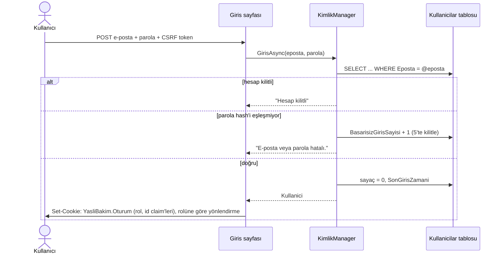

# Kimlik Doğrulama ve Yetkilendirme: Güvenlik Notu (Hafta 5)

## Özet

| Konu | Uygulama |
|---|---|
| Parola saklama | PBKDF2-HMAC-SHA256, 600.000 iterasyon, kullanıcı başına 16 baytlık rastgele tuz. Düz metin hiçbir yerde tutulmaz veya loglanmaz. |
| Parola kuralı | En az 8 karakter, en az bir harf ve bir rakam. |
| Oturum | ASP.NET Core cookie authentication. Çerez şifreli ve imzalı, `HttpOnly`, `SameSite=Lax`, canlıda yalnızca HTTPS (`Secure`). 30 dk işlem yapılmazsa biter (sliding expiration). |
| Oturum geçerliliği | Her istekte hesabın hâlâ var, aktif ve aynı rolde olduğu kontrol edilir; değilse oturum hemen düşer. |
| Roller | `Yonetici`, `Bakici`, `Yasli`. Sayfalar `[Authorize(Roles = ...)]` ile korunur. |
| Varsayılan kural | Her sayfa giriş ister (fallback policy). Herkese açık olanlar (`Giris`, `Kayit`, `Privacy`, `Error`) açıkça `[AllowAnonymous]` ile işaretlenir. |
| Kayıt sahipliği | Bakıcı yalnızca kendisine atanmış yaşlıların verisini görür. Kontrol sunucuda, veritabanı sorgusunda yapılır. |
| Kaba kuvvet koruması | 5 hatalı denemede hesap 15 dakika kilitlenir; yönetici kilidi kaldırabilir. |
| Kullanıcı tespiti | Yanlış parola ve olmayan e-posta için aynı mesaj ve yaklaşık aynı yanıt süresi verilir. |
| CSRF | Tüm POST formlarında anti-forgery token kullanılır (Razor Pages varsayılanı). Çıkış da yalnızca POST ile yapılır. |
| Yetki yükseltme | Kayıt formunda rol alanı yoktur; herkese açık kayıt yalnızca bakıcı hesabı açar. |
| Açık yönlendirme | Girişten sonra `ReturnUrl` yalnızca site içi bir adresse kullanılır (`Url.IsLocalUrl`). |

## Akışlar

Sonraki her istekte: çerez çözülür, ardından `OturumDogrulayici` hesabı kontrol eder, `[Authorize(Roles)]` rolü kontrol eder ve sayfa içinde kayıt sahipliği kontrol edilir.

## Rol / sayfa matrisi

| Sayfa | Anonim | Yaşlı | Bakıcı | Yönetici |
|---|---|---|---|---|
| `/Hesap/Giris`, `/Hesap/Kayit` | ✅ | ✅ | ✅ | ✅ |
| `/` Genel bakış | → giriş | ⛔ | ✅ yalnız kendi yaşlıları | ✅ hepsi |
| `/Yaslilar/Detay/{id}` | → giriş | ⛔ | ✅ yalnız atanmışsa | ✅ |
| `/Panelim` (acil buton) | → giriş | ✅ yalnız kendisi | ⛔ | ⛔ |
| `/Yonetim/Kullanicilar` | → giriş | ⛔ | ⛔ | ✅ |

Tablodaki her hücre [YetkiTestleri.cs](../YasliBakim.Tests/YetkiTestleri.cs) içinde gerçek HTTP isteğiyle test edilir.

## Demo hesapları (yalnızca geliştirme ortamı)

Tüm hesapların parolası `Demo1234`. Veritabanında yalnızca hash'i durur.

| E-posta | Rol | Görebildikleri |
|---|---|---|
| `yonetici@ornek.test` | Yönetici | Her şey + kullanıcı listesi |
| `selin@ornek.test` | Bakıcı | Ayşe, Fatma, Zeynep |
| `murat@ornek.test` | Bakıcı | Mehmet, Hasan |
| `elif@ornek.test`, `can@ornek.test` | Bakıcı (aile yakını) | Kendi yakınları |
| `ayse@ornek.test`, `hasan@ornek.test` | Yaşlı | Yalnızca kendi paneli |

Bu hesaplar `Program.cs` içinde yalnızca `IsDevelopment()` iken oluşturulur; canlı ortamda oluşmaz.

## Bilinen sınırlar / sonraki adımlar

- **Parola sıfırlama** ve **e-posta doğrulama** yok (e-posta gönderimi gerektirir).
- **İki adımlı doğrulama (2FA)** yok.
- Hesap kilidi IP'ye değil hesaba bağlı. Saldırgan bir kişinin hesabını bilerek kilitleyebilir (hizmet engelleme); IP tabanlı hız sınırlama (`AddRateLimiter`) eklenebilir.
- Kilitli hesapta farklı bir mesaj gösterildiği için o e-postanın kayıtlı olduğu anlaşılabilir. Yaşlı kullanıcılar için anlaşılır mesaj tercih edildi.
- Yaşlı hesapları şimdilik yalnızca örnek veriyle oluşuyor; yönetici ekranından yaşlı hesabı açma sonraki haftalarda eklenecek.

## OWASP Top 10 ile ilişkisi

| OWASP (2021) | Önlem |
|---|---|
| A01 Broken Access Control | Fallback policy, `[Authorize(Roles)]`, kayıt sahipliği (IDOR) kontrolü, yaşlı kimliğinin formdan değil oturumdan alınması |
| A02 Cryptographic Failures | PBKDF2 + tuz, şifreli çerez, canlıda HTTPS + HSTS |
| A03 Injection | EF Core parametreli sorgular; Razor çıktıyı otomatik HTML-encode eder (XSS) |
| A04 Insecure Design | Rol formdan seçilemez; yetkilendirme yalnızca arayüzde (menüde) değil sunucuda |
| A07 Identification and Authentication Failures | Parola kuralı, hesap kilidi, aynı hata mesajı, oturum süresi ve çıkış |
| A09 Security Logging and Monitoring Failures | Başarısız ve başarılı girişler loglanır (parola loglanmaz) |

## Sözlü sınav soruları

**1. Parolayı neden hash'liyorsun, tuz (salt) nedir?**
Veritabanı sızarsa saldırgan parolaları doğrudan görmesin diye. Hash tek yönlüdür: hash'ten parola geri hesaplanamaz, girişte girilen parola aynı şekilde hash'lenip karşılaştırılır. **Tuz**, her kullanıcı için üretilen rastgele bir değerdir ve parolayla birlikte hash'lenir. Bu sayede aynı parolayı kullanan iki kişinin hash'i farklı olur (veritabanımızda 7 demo hesabın parolası aynı ama hash'leri farklı) ve önceden hesaplanmış "parola → hash" tabloları (rainbow table) işe yaramaz. SHA-256 tek başına çok hızlı olduğu için PBKDF2 ile 600.000 kez tekrarlatıp tahmin denemesini bilerek yavaşlattık.

**2. Oturum (session) ve token farkı nedir?**
Bizim kullandığımız **çerez tabanlı oturumda** tarayıcı her istekte sunucunun verdiği şifreli çerezi otomatik gönderir. Sunucu çerezi çözer ve her istekte hesabı kontrol eder; çıkışta veya hesap kapatılınca oturum hemen biter. **Token (JWT)** ise imzalı bir metindir; istemci onu `Authorization: Bearer` başlığıyla kendisi gönderir. Sunucu durum tutmaz, imzayı doğrulamak yeterlidir. Bu yüzden mobil uygulamalar ve API'ler için uygundur, ama süresi dolmadan iptal etmek zordur. Bizim projemiz sunucuda render edilen bir web uygulaması olduğu için çerez oturumu seçtik.

**3. Rol tabanlı erişimi nasıl uyguladın?**
Rol, giriş sırasında çerezin içine claim olarak yazılır. Kullanıcı bunu değiştiremez, çünkü çerez sunucunun anahtarıyla imzalıdır. Sayfalarda `[Authorize(Roles = Roller.Yonetici)]` gibi öznitelikler vardır; ASP.NET Core sayfa kodu çalışmadan önce rolü kontrol eder. Bunun üstüne kayıt düzeyinde bir kontrol daha yaptım: `Yaslilar/Detay` sayfasında bakıcı rolü yetmez, `BakiciManager.YasliyaAtanmisMiAsync` ile o yaşlıya gerçekten atanmış mı diye bakılır; atanmamışsa `Forbid()` döner. Menüdeki linklerin gizlenmesi yalnızca görünüm içindir, asıl kontrol sunucudadır.

**4. Başarısız giriş denemesinde ne oluyor?**
`KimlikManager.GirisAsync` kullanıcının `BasarisizGirisSayisi` alanını 1 artırır ve "E-posta veya parola hatalı." mesajını döner. Bu mesaj, e-posta sistemde olmasa da aynıdır; olmayan e-postada da sahte bir hash doğrulaması yapılır ki yanıt süresinden de anlaşılmasın. 5. hatada `KilitBitisZamani` 15 dakika sonrasına ayarlanır; bu sürede doğru parola girilse bile giriş reddedilir. Başarılı girişte sayaç sıfırlanır. Deneme e-posta ve IP ile loglanır, parola loglanmaz.

**5. Yetkisiz kullanıcı korumalı sayfaya giderse ne olur?**
İki durum var. **Giriş yapmamışsa** (kimliği doğrulanmamışsa) `/Hesap/Giris?ReturnUrl=...` sayfasına yönlendirilir (302); girişten sonra gitmek istediği sayfaya döner. **Giriş yapmış ama yetkisi yoksa** (ör. bakıcı `/Yonetim/Kullanicilar`'a giderse) `/Hesap/ErisimEngellendi` sayfasına yönlendirilir ve 403 döner. Sayfanın kodu hiç çalışmaz, veri sorgulanmaz.

## Teorik kavramlar

- **Kimlik doğrulama (authentication):** "Sen kimsin?" sorusunun cevabı. E-posta ve parola ile yapılır.
- **Yetkilendirme (authorization):** "Bunu yapmaya iznin var mı?" sorusunun cevabı. Rol ve kayıt sahipliği ile yapılır. Önce kimlik doğrulanır, sonra yetki kontrol edilir (`UseAuthentication` → `UseAuthorization`).
- **Hash ve tuz:** Hash tek yönlü bir fonksiyondur; tuz, aynı girdinin farklı hash üretmesini sağlayan rastgele değerdir.
- **JWT / oturum:** Durumsuz imzalı token ile sunucu kontrollü çerez oturumunun farkı (soru 2).

## Yapay zekâ kullanımı

Yapay zekâ; OWASP parola saklama önerileri (PBKDF2 iterasyon sayısı), cookie güvenlik ayarları, IDOR ve kullanıcı tespiti (user enumeration) gibi yaygın açıklar ve bunların test edilmesi için kullanıldı. Öneriler 28 kimlik/yetki testiyle (`dotnet test`) ve uygulama LocalDB üzerinde çalıştırılarak doğrulandı.
