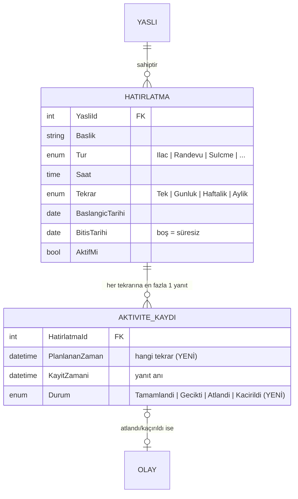

# Çekirdek Modül A: İlaç / Aktivite Hatırlatma (Hafta 6)

Bakıcı, yaşlı için ilaç, randevu, su, yemek ve egzersiz hatırlatmaları tanımlar. Yaşlı, panelinden her tekrarı **"Yaptım"** ya da **"Atla"** diye yanıtlar. Süresi içinde yanıt gelmezse sistem o dozu **kaçırıldı** olarak işaretler. İlaç ve randevularda yakınlara alarm (olay) oluşur.

## Dosyalar

| Katman | Dosya | Görev |
|---|---|---|
| Çekirdek mantık | [HatirlatmaZamanlayici.cs](../YasliBakim.Business/Zamanlama/HatirlatmaZamanlayici.cs) | Hangi gün/saatte tekrar var? (saf hesaplama) |
| İş kuralları | [HatirlatmaKurallari.cs](../YasliBakim.Business/Zamanlama/HatirlatmaKurallari.cs) | Onay penceresi, zamanında/geç, kaçırma, alarm kuralları |
| Servis | [HatirlatmaManager.cs](../YasliBakim.Business/Concrete/HatirlatmaManager.cs) | Hatırlatma ekleme/düzenleme + doğrulama |
| Servis | [HatirlatmaTakipManager.cs](../YasliBakim.Business/Concrete/HatirlatmaTakipManager.cs) | Günlük plan, onay/geri bildirim, kaçırma, uyum oranı |
| Zamanlayıcı | [KacirilanHatirlatmaServisi.cs](../yaslibakimapp/Servisler/KacirilanHatirlatmaServisi.cs) | Her dakika kaçırma kontrolünü çalıştırır |
| Sayfa | [Hatirlatmalar/Duzenle](../yaslibakimapp/Pages/Hatirlatmalar/Duzenle.cshtml.cs) | Bakıcı: hatırlatma ekle/düzenle |
| Sayfa | [Yaslilar/Detay](../yaslibakimapp/Pages/Yaslilar/Detay.cshtml.cs) | Bakıcı: bugünkü plan, 7 günlük uyum, pasife al/aktif et |
| Sayfa | [Panelim](../yaslibakimapp/Pages/Panelim.cshtml.cs) | Yaşlı: bugünkü plan, Yaptım/Atla |
| Test | [ZamanlayiciTestleri](../YasliBakim.Tests/ZamanlayiciTestleri.cs), [HatirlatmaTestleri](../YasliBakim.Tests/HatirlatmaTestleri.cs), [HatirlatmaSayfaTestleri](../YasliBakim.Tests/HatirlatmaSayfaTestleri.cs) | 34 test |

## Veri modeli



- **Hatırlatma = kural, tekrar = hesap.** Veritabanında "30 Ekim 08:00 dozu" diye ayrı bir satır yoktur. Satırda yalnızca kural durur ("her gün 08:00, 15 Ekim'den itibaren"). Tekrarlar ekranda gerektiğinde `HatirlatmaZamanlayici` ile hesaplanır. Böylece süresiz bir günlük hatırlatma için binlerce satır üretilmez.
- **Yanıt = AktiviteKaydi.** Bir tekrara yanıt verildiğinde (ya da süresi dolunca) bir kayıt yazılır. `PlanlananZaman` hangi doza ait olduğunu, `KayitZamani` ne zaman yanıtlandığını gösterir.
- **`(HatirlatmaId, PlanlananZaman)` UNIQUE:** aynı doz iki kez onaylanamaz. Arka plan servisi ile yaşlı aynı anda yazsa bile veritabanı ikinci kaydı reddeder.
- **CHECK:** hatırlatma onayında `PlanlananZaman` zorunludur (`CK_AktiviteKaydi_Tur`).
- Migration: `HatirlatmaTakibi`. Mevcut kayıtların `PlanlananZaman` alanı, kayıt gününe hatırlatmanın saati eklenerek elle yazılmış bir SQL adımıyla dolduruldu.

## Tekrarlama kuralları

| Tekrar | Gerçekleştiği günler |
|---|---|
| Tek | Yalnızca başlangıç günü (bitiş otomatik başlangıca eşitlenir) |
| Her gün | Başlangıç ile bitiş arasındaki her gün |
| Her hafta | Başlangıç tarihinin haftanın hangi günüyse (ör. her Pazartesi) |
| Her ay | Başlangıç tarihinin ay günü. 31'inde başlayan hatırlatma, 30 çeken aylarda 30'unda, Şubat'ta 28'inde olur. |

Pasif veya bitiş tarihi geçmiş hatırlatma hiçbir gün gerçekleşmez.

## Zamanlama ve onay (iş kuralları)

```
 planlanan − 60 dk          planlanan       + 30 dk                     + 120 dk
       │── onay açılır ──────┼── Tamamlandı ──┼──────── Gecikti ──────────┼── Kaçırıldı ──▶
       (öncesinde "Bekliyor", buton yok)                                     (artık onaylanamaz)
```

| Durum | Ne zaman |
|---|---|
| Bekliyor | Planlanan saate 1 saatten fazla var |
| Onay bekleniyor | Pencere açık; panelde **Yaptım / Atla** butonları görünür |
| Tamamlandı | İlk 30 dakika içinde "Yaptım" |
| Gecikti | 30. dakika ile 2. saat arasında "Yaptım" |
| Atlandı | Yaşlı "Atla" dedi |
| Kaçırıldı | 2 saat içinde hiç yanıt yok; sistem otomatik işaretler |

**Alarm kuralı:** yalnızca **ilaç** (seviye Yüksek) ve **randevu** (seviye Orta) atlandığında ya da kaçırıldığında yakınlara olay oluşur. Su, yemek ve egzersiz kaçırmaları kaydedilir ve uyum oranına girer, ama alarm üretmez.

## Doğrulama ve iş kuralları

| Kural | Nerede | Neden |
|---|---|---|
| Başlık zorunlu, en çok 100 karakter; açıklama en çok 500 | Form (DataAnnotations) + servis + veritabanı | Her katmanda; formu atlayan istek de reddedilir |
| Başlangıç geçmişte olamaz (yeni kayıtta veya başlangıç değiştirilince) | Servis | Geçmiş dozlar anında "kaçırıldı" olur ve sahte alarm üretirdi |
| Bitiş ≥ başlangıç | Servis + CHECK | |
| Aynı yaşlıya aynı saatte aynı başlıklı ikinci aktif hatırlatma yok | Servis | İlacın yanlışlıkla iki kez tanımlanıp çift doz hatırlatılmaması |
| Tür ve tekrar geçerli enum değeri olmalı | Servis (`Enum.IsDefined`) | Formdan `Tur=42` gibi uydurma bir değer gönderilemez |
| Güncellemede yaşlı, oluşturan bakıcı ve aktiflik değişmez | Servis (alan alan kopyalama) | Overposting: formdan `YasliId` gönderilip hatırlatma başka yaşlıya taşınamaz |
| Onay penceresi dışında yanıt verilemez | Takip servisi | Akşam ilacının sabahtan "alındı" yapılmaması |
| Gönderilen saat gerçekten bir tekrar olmalı | Takip servisi | Uydurma bir `planlanan` değeri ile sahte kayıt açılamaz |
| Bir doz bir kez yanıtlanır | Servis + UNIQUE indeks | |
| Onay geçmişi olan hatırlatma silinmez, pasife alınır | Servis + FK `NO ACTION` | Geçmiş uyum verisi kaybolmaz |
| Hatırlatma oluşturulmadan önceki tekrarlar kaçırılmış sayılmaz | Takip servisi | Yeni eklenen hatırlatma geçmiş için alarm üretmez |

## Erişim / sahiplik

| İşlem | Kim yapabilir | Kontrol |
|---|---|---|
| Hatırlatma ekle/düzenle, pasife al/aktif et | Yönetici, ya da **o yaşlıya atanmış** bakıcı | `YasliErisimi.YasliyaErisebilirMiAsync` |
| Düzenlemede hangi yaşlı? | Her zaman veritabanındaki kayıttan alınır | Adres çubuğundaki `yasliId`'ye güvenilmez |
| Yaptım / Atla | Yalnızca hatırlatmanın sahibi olan yaşlı | Yaşlı kimliği oturumdan gelir; servis `h.YasliId == yasliId` kontrol eder |

## Diğer modüllerle entegrasyon

| Modül | Bağlantı |
|---|---|
| Veritabanı (Hafta 4) | Mevcut `Hatirlatmalar` ve `AktiviteKayitlari` tabloları genişletildi; yeni tablo açılmadı |
| Kimlik / roller (Hafta 5) | Sayfalar `[Authorize(Roles)]` ile korunur, sahiplik `YasliErisimi` ile kontrol edilir |
| Anomali bildirimi / Olay | Atlanan ve kaçırılan ilaç/randevu `Olay(KacirilanHatirlatma)` üretir; bakıcının genel bakış ekranında görünür |
| Yakın paneli | Detay sayfasında bugünkü plan ve son 7 günün uyum oranı (%) |
| Yaşlı paneli | Acil butonun altında bugünkü plan ve büyük Yaptım/Atla butonları |

## Sözlü sınav soruları

**1. Hatırlatma onaylanmazsa ne oluyor?**
Planlanan saatten 1 saat önce panelde "Yaptım / Atla" butonları açılır. 2 saat geçtiği hâlde yanıt yoksa, her dakika çalışan `KacirilanHatirlatmaServisi` `HatirlatmaTakipManager.KacirilanlariIsleAsync` metodunu çağırır. Bu metot o doz için `Durum = Kacirildi` olan bir `AktiviteKaydi` yazar. Hatırlatma ilaç veya randevuysa aynı transaction içinde bir `Olay` (KacirilanHatirlatma) da oluşur ve bakıcının ekranına düşer. Bu andan sonra doz artık onaylanamaz. Kaçırılan doz uyum oranını da düşürür. Servis aynı dozu ikinci kez işaretlemez; hem önce kontrol eder hem de UNIQUE indeks engeller.

**2. Tekrarlayan hatırlatmayı nasıl modelledin?**
Her tekrar için ayrı satır yazmadım; hatırlatmayı bir **kural** olarak sakladım: `Saat` + `Tekrar` (Tek/Günlük/Haftalık/Aylık) + `BaslangicTarihi` + `BitisTarihi`. Haftalık için hafta günü, aylık için ay günü başlangıç tarihinden alınır. `HatirlatmaZamanlayici.GerceklesirMi(h, tarih)` bir tarihte tekrar olup olmadığını hesaplar. Bir tekrar yanıtlandığında ise `AktiviteKaydi.PlanlananZaman` ile hangi doza ait olduğu kaydedilir. Kısacası kural tek satırdır, sonuçlar tekrar başına bir satırdır.

**3. Bu modülün verisini nasıl modelledin?**
`Hatirlatma` (kural) ile `AktiviteKaydi` (tekrar başına yanıt) arasında 1-N ilişki var. Atlanan veya kaçırılan kayıttan 0..1 ilişkiyle `Olay` oluşur. Bu hafta iki şey ekledim: tekrarı tanımlayan `PlanlananZaman` alanı ve `Kacirildi` durumu. `(HatirlatmaId, PlanlananZaman)` üzerindeki UNIQUE indeks çift onayı engelliyor; CHECK kısıtı onay kaydında planlanan zamanı zorunlu tutuyor. Ekranda görünen "Bekliyor / Onay bekleniyor" gibi durumlar veritabanında saklanmaz; kayıt ve şimdiki saatten hesaplanır (`PlanDurumu`).

**4. Bu modülde hangi iş kuralını neden koydun?**
Örnek olarak üçü:
- **Onay penceresi (−60 dk / +120 dk):** akşam ilacı sabah "alındı" işaretlenirse yakınlar yanlış bilgilendirilir.
- **Aynı saatte aynı başlıklı ikinci aktif hatırlatma yok:** aynı ilaç iki kez tanımlanırsa yaşlıya çift doz hatırlatılır, bu da sağlık riski.
- **Yalnızca ilaç ve randevu alarm üretir:** su veya yürüyüş kaçırıldığında da alarm gitseydi yakınlar bildirimlere alışıp önemli olanı kaçırırdı (alarm yorgunluğu).

Tüm kurallar `HatirlatmaKurallari` ve servislerde toplu durur ve her biri için test vardır.

**5. Bu modülü diğer modüllerle nasıl entegre ettin?**
Yeni tablo açmadan Hafta 4'teki tablolarla çalışıyor. Hafta 5'teki rolleri ve `YasliErisimi` sahiplik kontrolünü kullanıyor: bakıcı yalnızca kendi yaşlısının hatırlatmasını yönetebilir, yaşlı yalnızca kendi hatırlatmasını yanıtlayabilir. Atlanan veya kaçırılan ilaç, mevcut `Olay` tablosuna yazıldığı için anomali bildirimi ve yakın paneli ekstra kod gerektirmeden bunu gösteriyor. Saat (`TimeProvider`) dependency injection ile verildiği için tüm kurallar "şu an saat 09:10" gibi sabit bir zamanla test edilebiliyor.

## Teorik kavramlar

- **Veri modeli:** kural (hatırlatma) ile olgu (tekrar başına yanıt) ayrımı; türetilebilen veri (ekran durumu) saklanmaz.
- **İş kuralı / doğrulama:** biçim kontrolü formda, anlam kontrolü serviste, son savunma veritabanında (UNIQUE, CHECK, FK).
- **Modülerlik:** zamanlama ve kurallar veritabanından ve web'den bağımsız saf sınıflardır. Tek başlarına test edilir; ileride mobil uygulama veya SMS bildirimi aynı sınıfları kullanabilir.

## Bilinen sınırlar

- Haftalık hatırlatma tek gün içindir; "Pazartesi + Perşembe" için iki hatırlatma tanımlanır.
- Bildirim yalnızca uygulama içinde görünür; SMS veya e-posta gönderimi yok.
- Arka plan servisi uygulama açıkken çalışır. Sunucu kapalıyken geçen dozlar, uygulama açılınca (dün + bugün için) işaretlenir.

## Yapay zekâ kullanımı

Yapay zekâ; tekrar modelleme seçenekleri (kural mı, satır mı), ay sonu kenar durumu, onay penceresi kuralları, overposting ve sahiplik kontrolü örnekleri, `TimeProvider` ile test edilebilir saat kullanımı için kullanıldı. Kurallar 34 yeni testle ve uygulama LocalDB'de çalıştırılarak doğrulandı.
