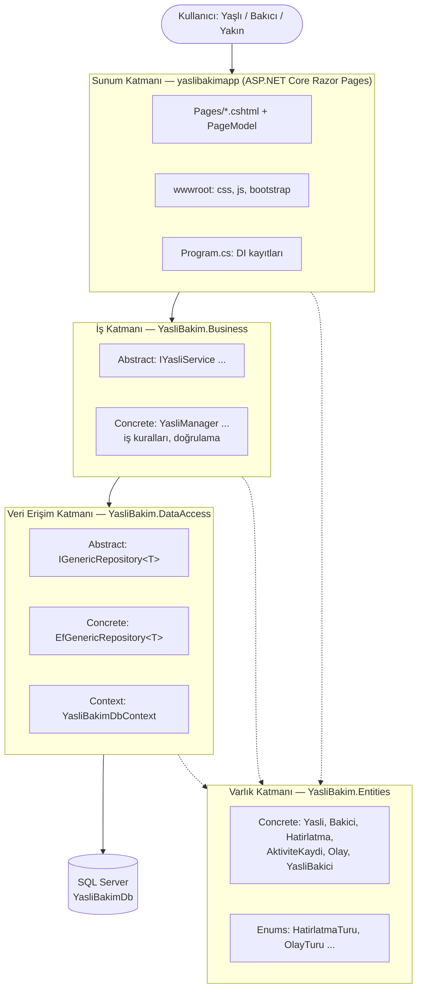

# Mimari Şema

Proje **katmanlı mimari** (Sunum / İş / Veri) ile kurulmuştur. Her katman ayrı bir C# projesidir. Bağımlılıklar yalnızca yukarıdan aşağıya doğrudur.



## Klasör yapısı

```
YasliBakim.slnx
├── YasliBakim.Entities/        Varlık sınıfları (veritabanı tabloları)
│   ├── Concrete/               BaseEntity, Yasli, Bakici, Hatirlatma ...
│   └── Enums/                  Sabit değer listeleri
├── YasliBakim.DataAccess/      Veritabanı erişimi (EF Core)
│   ├── Abstract/               Repository arayüzleri
│   ├── Concrete/               EF Core implementasyonları
│   ├── Context/                DbContext, ilişkiler, kısıtlar, indeksler (Fluent API)
│   ├── Migrations/             EF Core migration'ları
│   └── Seed/                   Sentetik örnek veri
├── YasliBakim.Business/        İş kuralları
│   ├── Abstract/               Servis arayüzleri
│   └── Concrete/               Servis implementasyonları (Manager)
├── yaslibakimapp/              Sunum katmanı (Razor Pages web uygulaması)
├── YasliBakim.Tests/           CRUD ve kısıt testleri (xUnit + SQLite in-memory)
├── database/                   Şema script'i ve örnek SQL sorguları
└── docs/                       ER diyagramı, mimari şema, veritabanı tasarımı
```

## Gerekçeler

- **Sorumlulukların ayrılması:** Sayfalar (Razor Pages) veritabanını doğrudan bilmez; yalnızca servis arayüzlerini çağırır. Veritabanı değişirse (ör. SQL Server → SQLite) sadece DataAccess katmanı değişir.
- **Abstract / Concrete ayrımı:** Üst katmanlar arayüze bağımlıdır, somut sınıf `Program.cs` içinde Dependency Injection ile verilir. Bu sayede test için sahte (mock) sınıflar kullanılabilir.
- **Ayrı Entities projesi:** Varlıklar tüm katmanlarca kullanılır, ancak hiçbir katmana bağımlı değildir. Bu döngüsel bağımlılığı önler.
- **Generic repository:** Altı varlık için aynı CRUD kodunu tekrar yazmamak için kullanılır.

## Bağımlılık yönü

| Proje | Referans verdiği projeler |
|---|---|
| YasliBakim.Entities | — |
| YasliBakim.DataAccess | Entities |
| YasliBakim.Business | Entities, DataAccess |
| yaslibakimapp | Entities, DataAccess, Business |
